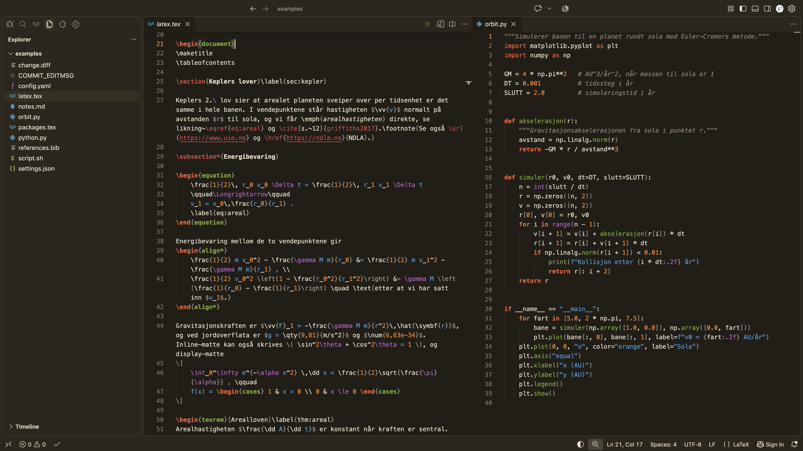
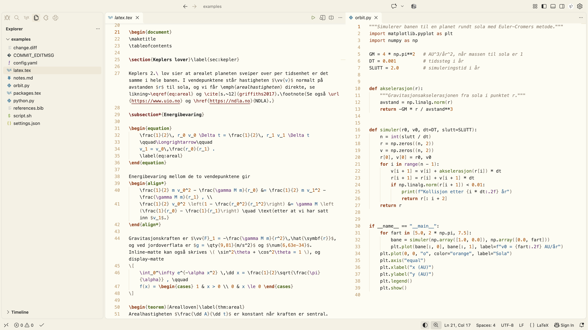
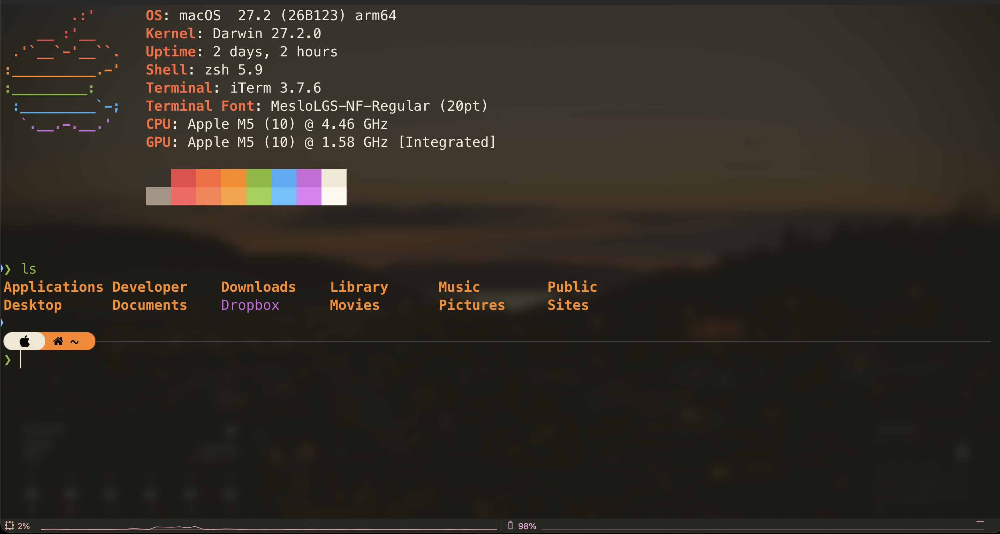
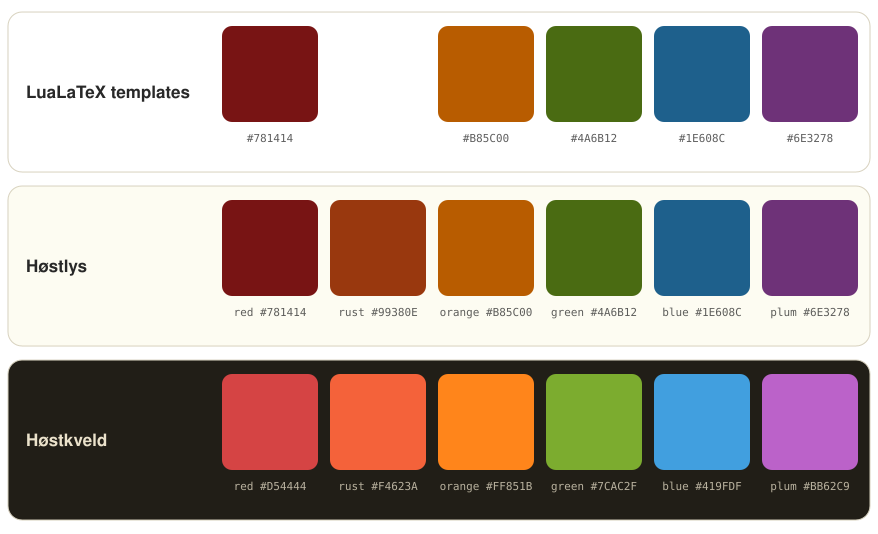
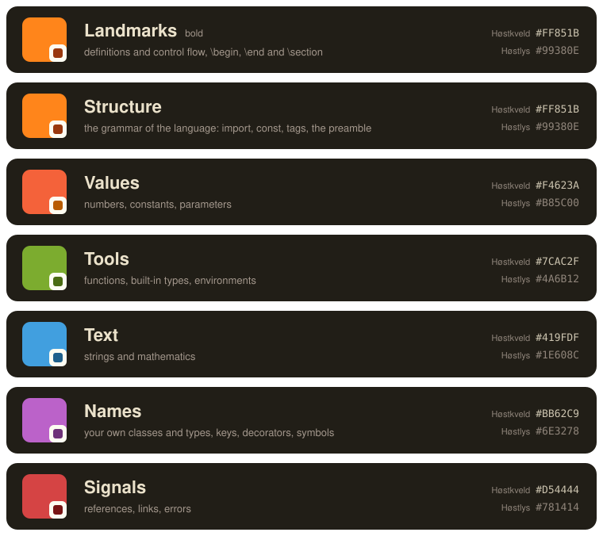

# Høst

<!-- First paragraph: written by Dag-Morten in his own words. Replace the placeholder below before publishing. -->
*[Placeholder for the first paragraph, in my own words: why I made Høst, and what it is for.]*

A light and a dark theme in earth tones for VS Code and iTerm. *Høst* is Norwegian for autumn.

**Høstlys** (autumn light) is the light theme and **Høstkveld** (autumn evening) the dark one. The palette is six deep autumn colours on warm, slightly rustic earth tones. The themes are tuned for LaTeX and Python, and cover the rest of VS Code as well.







## Install

### VS Code

1. Open the Extensions view (Cmd+Shift+X, or Ctrl+Shift+X on Windows and Linux), search for **Høst** and choose **Install**. From a terminal:

   ```zsh
   code --install-extension dagmortensj.hoest-theme
   ```

2. Press Cmd+K Cmd+T (Ctrl+K Ctrl+T on Windows and Linux) and pick **Høstlys** or **Høstkveld**.

The extension is also in this repository as [`vscode/hoest-theme.vsix`](vscode/hoest-theme.vsix). Drag the file into the Extensions view, or choose **Extensions → … → Install from VSIX…**. That is the way to install it in VSCodium and Cursor, and a new version installs over the old one in the same way. Before version 3.6.1 the extension ID was `dagmorten.hoest-theme`, and before 3.5 `dagmorten.host-theme`. VS Code sees each as a different extension, so remove an old one first:

```zsh
code --uninstall-extension dagmorten.hoest-theme
code --uninstall-extension dagmorten.host-theme
```

While Høstlys or Høstkveld is active, a button at the right of the status bar switches between them. The same command is in the command palette as **Høst: Switch between Høstlys and Høstkveld**. It works as it is. If you also want VS Code's own light/dark switching, for example when it follows the system appearance, set the pair in your settings:

```jsonc
"workbench.preferredLightColorTheme": "Høstlys",
"workbench.preferredDarkColorTheme": "Høstkveld",
```

For the LaTeX colours, install [LaTeX Workshop](https://marketplace.visualstudio.com/items?itemName=James-Yu.latex-workshop). For the best Python colours, use Pylance, which comes with the Python extension. The theme works without both.

### iTerm

1. Download [`iterm/Høstkveld.itermcolors`](iterm/Høstkveld.itermcolors) and [`iterm/Høstlys.itermcolors`](iterm/Høstlys.itermcolors).
2. Double-click each file to import it.
3. Pick the preset under **Settings → Profiles → Colors → Color Presets**.

Høstkveld in iTerm glows a little more than in VS Code, since a terminal is used in short sessions. The cyan slot holds rust, so all six palette colours are available to the prompt, `ls` and other tools, and turquoise never appears.

## The palette



Each colour has one role, in every language and in both themes. The full rules, with bold, italic and the cases where a grammar sets limits, are in [`docs/rules.md`](docs/rules.md).



| Colour | Role | Examples |
|---|---|---|
| Rust | Structure and keywords, landmarks in bold | `def`, `class`, `if`, `return` in bold, `import`, `const`, `\begin`, the preamble |
| Orange | Values and input | `3.14`, `True`, `None`, parameters in italic |
| Green | Tools that do something | function names, `print`, built-in types such as `int` and `str`, CSS properties, `equation`, `\draw` |
| Blue | Text and mathematics | `"text"`, everything inside `$...$` |
| Plum | Classes and types, and symbols | your classes and those of libraries, `self` in italic, `@property`, keys in JSON and YAML, `\n`, `\gamma` |
| Red | Signals and references | `\section`, `\ref`, `\cite`, links, errors |

Comments, braces and brackets are grey. Variables, operators, prose and ordinary LaTeX commands such as `\frac` and `\label` keep the text colour. Bold marks landmarks, what you look for when scrolling: definitions and control flow in every language, `\begin`, `\end` and sections in LaTeX, and headings in Markdown. Italic marks placeholders, as variables are set in mathematics: parameters, `self` and `this`, and `#1` in LaTeX.

Høstkveld is derived from Høstlys by a single rule in the OKLCH colour space, so the colours keep their order and roles in both themes. [`docs/palette.md`](docs/palette.md) has every colour with its contrast, the rule, the terminal colours and the details of what the theme covers.

## What it covers

- The whole VS Code workbench, including diff and merge views, debugging, testing, notebooks, the command palette, settings and chat. Nothing falls back on VS Code's default blues.
- LaTeX with LaTeX Workshop, plus four small injection grammars for what LaTeX Workshop leaves as plain text: tikz, circuitikz and tikzcd, option keys such as `[width=0.8\linewidth]`, siunitx, mhchem and file paths.
- Python, with semantic highlighting for Pylance.
- The same roles in TypeScript, JavaScript, Java, C#, C, C++, Go, Rust, Kotlin, Swift, PHP, Ruby, SQL, HTML and CSS, with a test file for each in `test/`.
- Markdown with maths, BibTeX, JSON, YAML, TOML, shell, diff, git commits and logs.

## Repository layout

| Path | Contents |
|---|---|
| `src/palette.py` | Every colour, and the rule that derives Høstkveld from Høstlys |
| `src/build.py` | Turns the palette into the VS Code themes, the iTerm presets, `docs/palette.svg`, `docs/roles.svg` and `docs/roles.png` |
| `src/colorspace.py` | OKLCH conversion, the sRGB gamut and WCAG contrast |
| `src/icon.py` | Draws the extension icon from the palette (needs Pillow) |
| `vscode/` | The VS Code extension: themes, injection grammars, the status bar button, the icon, the changelog and the packaged `.vsix` |
| `iterm/` | The iTerm presets |
| `examples/` | Realistic sample files, used for the screenshots |
| `test/` | One test file per language, at most 36 lines each, for checking every rule after a change |
| `docs/` | The colour rules, the palette in detail, and screenshots |

## Changing the colours

Every hex code lives in `src/palette.py`. After a change:

```zsh
python3 src/build.py --check        # rebuild themes and presets, print contrast and colours outside sRGB
cd vscode                           # then raise "version" in package.json and add a line to CHANGELOG.md
npx @vscode/vsce package -o hoest-theme.vsix
code --install-extension hoest-theme.vsix --force
```

The files in `vscode/themes/` and `iterm/` are generated, so edit the palette rather than those files.

## Credits

Høst is designed by Dag-Morten and made with [Claude](https://claude.ai). Apart from the first paragraph of this page, the documentation is written with Claude. The neutral tones come from [Gruvbox](https://github.com/morhetz/gruvbox) by Pavel Pertsev.

## License

[MIT](LICENSE)
